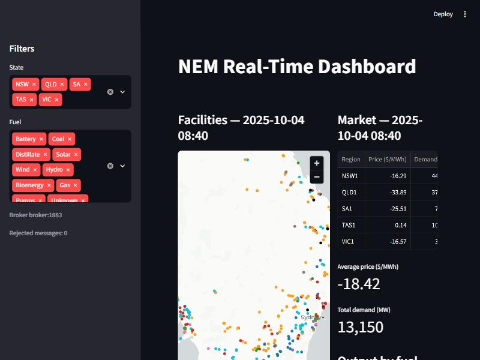
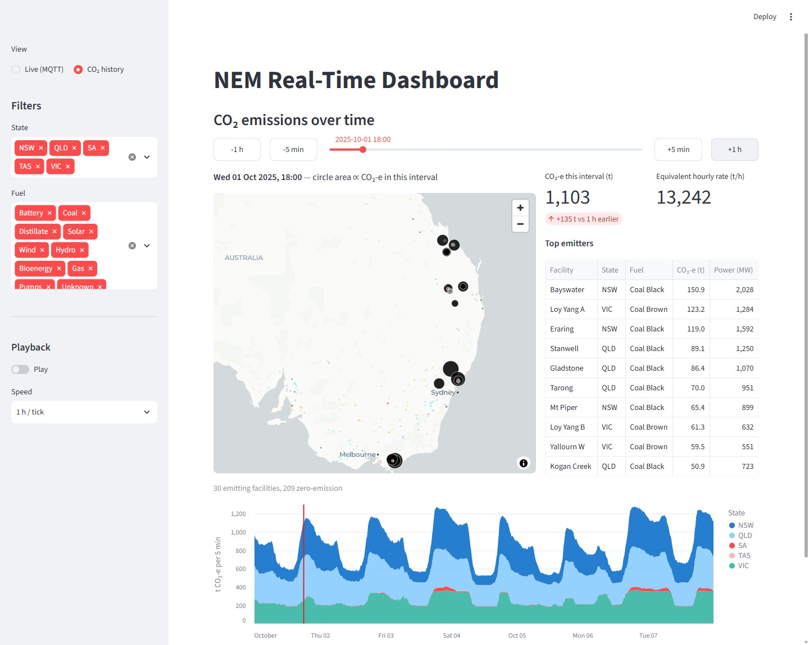
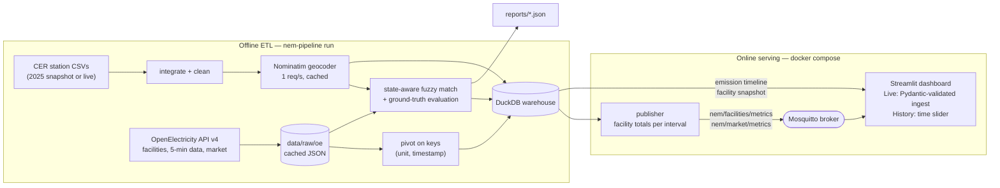

# NEM Real-Time Pipeline

[](https://www.python.org/)
[](https://duckdb.org/)
[](https://mosquitto.org/)
[](https://streamlit.io/)
[](docker-compose.yml)
[](tests)
[](tests)
[](pyproject.toml)

## Project Overview

An ETL and streaming pipeline for Australia's National Electricity Market (NEM). It pulls
5-minute generation, emissions, price and demand data from the OpenElectricity API, joins it with
the Clean Energy Regulator's (CER) renewable station register in a DuckDB warehouse, replays it
over MQTT and shows it on a live Streamlit map.

**Key finding.** The original version placed facilities on the map by fuzzy-matching their names
to geocoded CER stations. OpenElectricity publishes every facility's real coordinates, which made
it possible to check that join against ground truth. Only **10 of the 154 facilities it placed
(6.5%) were within 25 km of their real location**: 111 were matched to a station in a different
state and the median error was **729 km**. The refactor uses the official coordinates instead
(**484 of 486 facilities mapped, up from 154**) and keeps a corrected, state-aware fuzzy join only
for CER enrichment, where its precision rises from **17.3% to 75.4%**.



**CO₂ history view** — drag the time slider (5-minute steps), step ±5 min / ±1 h, or press Play to
watch emissions change across the week. Circle area is proportional to each facility's CO₂-e in
the selected interval; the chart below shows the weekly profile by state with the selected time
marked.



## Key Features

- **Measured, not assumed, data quality.** Name matching is scored against OpenElectricity's own
  coordinates: original join 6.5% correct placements → 99.6% coverage with official locations;
  fuzzy-join precision 17.3% → 75.4% with 0 cross-state matches (was 196).
- **Bug found in the original dashboard.** It kept only the *last* unit received per facility, so
  **19.7% of facility readings (82,010 of 415,331) showed the wrong output, off by 167 MW on
  average**. Readings are now summed per facility before publishing.
- **Reproducible, credit-aware extraction.** Raw API responses are cached; a full week for 486
  facilities is 22 requests and 77 MB of JSON, and re-runs cost no API credits. The original 2025
  CER lists are pinned from the Wayback Machine, because the live register has changed since.
- **Streaming with validated contracts.** Pydantic models validate every MQTT message on the
  consumer side; malformed messages are counted and dropped. End-to-end latency through a local
  broker is **p50 6.96 ms / p95 9.55 ms at QoS 1** with 0 of 4,032 messages lost.
- **Time-travel view of emissions.** A second dashboard mode queries DuckDB for any of the 2,016
  intervals: a draggable time slider with playback, an emissions-scaled map, the change against one
  hour earlier, the top emitters and a stacked weekly chart by state.
- **Production packaging.** Typed `src/` package with a Typer CLI, 128 tests (97% coverage), Ruff,
  a two-stage non-root Docker image slimmed from 965 MB to 709 MB, and a one-command compose stack.

## System Architecture



| Stage | Input | Processing | Output |
|---|---|---|---|
| CER clean | 3 CSVs, 360 rows | Unify headers, parse `"1,400.000"` capacities, strip descriptor suffixes, keep most advanced status per `(name, state)`, drop invalid states | `power_station_dim/fact` (star schema) |
| Geocode | 360 stations | Nominatim fallback chain: full name → name without generic suffix → postcode centroid; hits and misses cached | lat/lon + method per station |
| Extract | OE API | Facilities with an operating/committed unit; batches of 25 facilities × 7-day windows; retries with back-off | Raw JSON (cached) |
| Transform | 2,112,432 long rows | Pivot power/emissions on `(facility, unit, timestamp)`; timestamps converted to NEM time (UTC+10); idle 0/0 rows dropped | `facility_metrics` 568,237 rows, `market_metrics` 10,080 rows |
| Match | facilities × stations | Word-boundary normalisation, same-state candidates, `token_set_ratio ≥ 85` | `cer_facility_match`, evaluation report |
| Serve | warehouse | Sum units per facility per interval, one message per topic and interval | MQTT → dashboard |
| History | warehouse | Per-state totals for every interval; per-facility snapshot for the selected interval (parameterised DuckDB query) | CO₂ history view |

## Tech Stack

| Area | Tools |
|---|---|
| Language | Python 3.13, type hints, Google-style docstrings |
| Data | pandas 3.1, DuckDB 2.0, RapidFuzz 3.14, NumPy |
| Ingestion | requests (OpenElectricity v4 REST, CER, Nominatim), BeautifulSoup |
| Streaming | paho-mqtt 2.1, Eclipse Mosquitto 2.0 |
| UI | Streamlit 1.66, pydeck |
| Config | pydantic-settings (`.env`, `APP_` prefix), TOML parameters |
| Quality | pytest, pytest-cov, Ruff (lint + format) |
| Delivery | Docker (two-stage, non-root), docker compose, PyCharm run configurations |

## Quick Start

### Local

```bash
git clone https://github.com/daniel880830/nem-realtime-pipeline.git
cd nem-realtime-pipeline
python -m venv .venv && source .venv/bin/activate   # Windows: .venv\Scripts\activate
pip install -r requirements-dev.txt && pip install -e . --no-deps
cp .env.example .env    # then set APP_OPENELECTRICITY_API_KEY (free key at platform.openelectricity.org.au)
```

```bash
nem-pipeline run --method legacy     # reproduce the original logic  -> reports/run_legacy.json
nem-pipeline run --method improved   # fixed pipeline (run last: the dashboard serves this one)
```

The first run downloads about 77 MB from OpenElectricity and geocodes the CER stations at
1 request/second (about 5–6 minutes); later runs take about 4 seconds from cache.

```bash
docker compose up -d broker          # local MQTT broker on APP_HOST_MQTT_PORT (default 1883)
nem-pipeline publish --cycles 0      # replay the week in a loop (Ctrl+C to stop)
nem-pipeline dashboard               # http://localhost:8501
nem-pipeline benchmark --intervals 2016 --qos 1
```

Example message on `nem/market/metrics`:

```json
{"timestamp": "2025-10-02 02:35",
 "data": [{"region": "NSW1", "price_aud_mwh": 71.4, "demand_mw": 6363.42}, "..."]}
```

### Docker (one command)

```bash
cp .env.example .env    # set the API key; change APP_HOST_* ports if 1883/8501 are taken
docker compose up --build
```

`pipeline` runs the ETL once; `publisher` and `dashboard` start only after it exits successfully
(`service_completed_successfully`) and the broker is healthy. All three share one image. Raw API
responses and geocodes are bind-mounted from `data/`, so containers reuse the local cache.

## Evaluation & Benchmarks

Data: OpenElectricity 5-minute data for 2025-10-01 00:00 → 2025-10-08 00:00 (NEM time), CER
registers as archived in 2025. Correct = matched coordinates within 25 km of the facility's
official OpenElectricity location.

### Original vs. improved (end to end)

| Metric | Original method | Improved | Source |
|---|---:|---:|---|
| CER stations after cleaning (360 rows in) | 353 (hyphen truncation merged 7) | 360 | `run_*.json` |
| CER stations geocoded | 97 / 353 (27.5%) | **341 / 360 (94.7%)** | `geocode_rate` |
| Facilities placed on the map | 154 / 486 (31.7%) | **484 / 486 (99.6%)** | `map_coverage` |
| …of which within 25 km of the real site | **10 (6.5%)** | 484 (official coordinates) | `legacy_fuzzy.precision` |
| Facilities placed in another state | 111 | 0 | `cross_state_matches` |
| Median / p90 placement error | 729 km / 1,448 km | 0 km | `median_error_km` |
| Dashboard readings showing a single unit instead of the facility total | 82,010 / 415,331 (19.7%) | 0 | `diagnostics.unit_overwrite` |

### Fuzzy-join algorithm alone (same 360 stations, same geocodes)

| Matcher | Matched | Precision (≤ 25 km) | Cross-state | Median error |
|---|---:|---:|---:|---:|
| Original: substring term removal, `partial_ratio ≥ 70` → `token_sort ≥ 65`, any state | 314 | 17.3% (54 / 313) | 196 | 577 km |
| Improved: word-boundary normalisation, same state, `token_set_ratio ≥ 85` | 66 | **75.4% (49 / 65)** | **0** | 7.2 km |

The improved matcher trades recall for precision on purpose: most CER entries are small rooftop or
behind-the-meter sites that are not NEM facilities, so a confident "no match" is the right answer
for most facilities.

### Pipeline performance

| Measurement | Value |
|---|---|
| Full `run` from cache (Windows) | 3.99 s (extract 2.47 s, transform 1.14 s, load 0.22 s) |
| Full `run` from cache (Docker, Linux) | 4.19 s |
| First run geocoding (297 Nominatim requests at ≤ 1 req/s) | 326 s |
| Raw OpenElectricity cache | 77 MB, 22 requests |
| DuckDB warehouse | 8.66 MB |

### MQTT end-to-end (publisher → Mosquitto in Docker → subscriber, one week = 2,016 intervals)

| QoS | Messages delivered | Latency p50 | Latency p95 | Max | Throughput |
|---|---:|---:|---:|---:|---:|
| 0 | 4,032 / 4,032 | 5.14 ms | 8.56 ms | 59.2 ms | 594 msg/s |
| 1 | 4,032 / 4,032 | 6.96 ms | 9.55 ms | 58.1 ms | 545 msg/s |

73.2 MB in total, 18.1 KB per message on average (a facility message holds about 200 facilities).

### Docker image

| Image | Unpacked (`docker images`) | Compressed content |
|---|---:|---:|
| Two-stage build, `SLIM=0` | 965 MB | 223.6 MB |
| Two-stage build, `SLIM=1` (default) | **709 MB** | **168.3 MB** |

`SLIM=1` removes `tests/` directories, bytecode caches, type stubs and C/C++ headers, Arrow Flight
(RPC, unused), pydeck's Jupyter widget bundle, and pip/setuptools from both stages. pyarrow (160 MB)
remains because Streamlit needs it.

### Linux vs. Windows

The `improved` run inside Docker (Linux, Python 3.13.18) and on Windows (Python 3.13.5), both with
pandas 3.1.0, DuckDB 2.0.0 and RapidFuzz 3.14.6, produce identical values for every non-timing field
of the report.

### What did *not* reproduce

The original paired power with emissions (and price with demand) by row position. That is only
correct while every unit has identical timestamps for both metrics. On this extract the API
returned aligned series, so **0 rows were misaligned**; the issue is latent. A unit test removes two
readings and shows over 30% of rows shifting onto the wrong unit or interval, and keyed pivoting is
used regardless.

Measured on Windows 11, CPU "AMD64 Family 25 Model 97", Python 3.13.5; Docker Desktop with WSL2.
Raw numbers are in [`reports/`](reports).

## Project Background

The project began as a university data engineering team project for a two-person team. The
original scripts (archived in [`legacy/`](legacy)) built a DuckDB star schema of renewable stations,
streamed one week of NEM data over MQTT and visualised it in Streamlit. It was later refactored
into this repository as an individual effort: package structure, configuration, tests, Docker, and
an evaluation that reproduces the original logic first and then measures each fix against it.

## Project Structure

```text
nem-realtime-pipeline/
├── src/nem_pipeline/
│   ├── config.py          # pydantic-settings (.env, APP_ prefix) + validated TOML parameters
│   ├── schema.py          # column contracts and MQTT payload models
│   ├── cer.py             # CER scraping, integration, legacy vs improved cleaning
│   ├── geocode.py         # rate-limited, cached Nominatim geocoder
│   ├── extract.py         # OpenElectricity v4 client, raw cache, parsing
│   ├── transform.py       # keyed pivots (+ faithful positional legacy version)
│   ├── matching.py        # fuzzy joins and ground-truth evaluation
│   ├── warehouse.py       # DuckDB star schema and serving tables
│   ├── pipeline.py        # orchestration, stage timings, JSON reports
│   ├── publish.py         # MQTT replay
│   ├── benchmark.py       # end-to-end latency/throughput measurement
│   ├── cli.py             # nem-pipeline run | extract | publish | dashboard | benchmark
│   └── dashboard/         # logic.py (testable state, emission scaling) + app.py (live + CO₂ history views)
├── tests/unit/            # per-module tests with synthetic fixtures and fakes
├── tests/integration/     # offline end-to-end runs, CLI included
├── config/pipeline.toml   # extraction window, thresholds, topics
├── data/raw/cer_snapshot_2025/  # CER registers as archived in 2025
├── reports/               # run_legacy.json, run_improved.json, benchmark_mqtt.json
├── legacy/                # original scripts (keys redacted)
├── docker/mosquitto.conf
├── .run/                  # PyCharm run configurations
├── Dockerfile
└── docker-compose.yml
```

## Data sources and attribution

- Generation, emissions and market data: [OpenElectricity](https://openelectricity.org.au/) API
  (free key required; subject to its terms of use).
- Renewable station registers: [Clean Energy Regulator](https://cer.gov.au/markets/reports-and-data/large-scale-renewable-energy-data);
  2025 copies retrieved via the [Internet Archive](https://web.archive.org/).
- Geocoding: © OpenStreetMap contributors via [Nominatim](https://nominatim.org/), used within its
  1 request/second policy. Base map: © CARTO, © OpenStreetMap contributors.
